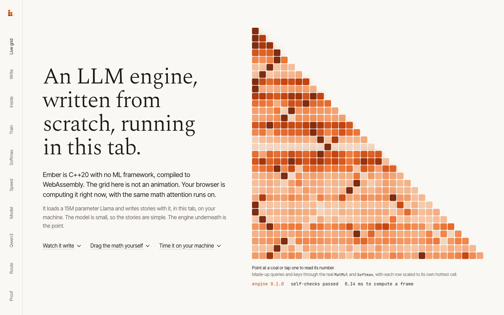
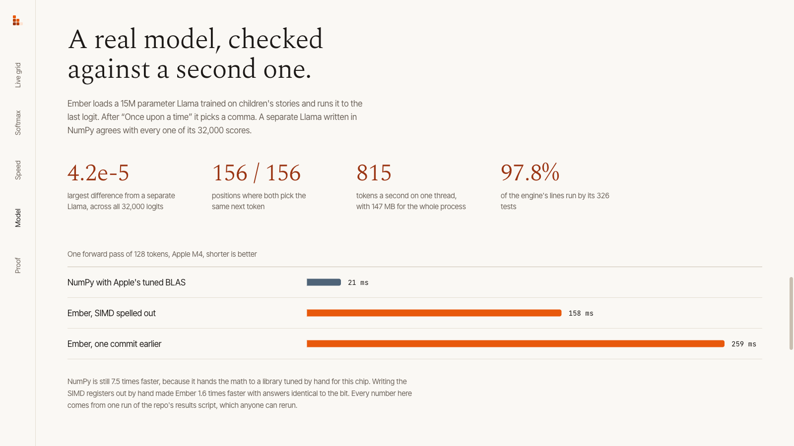
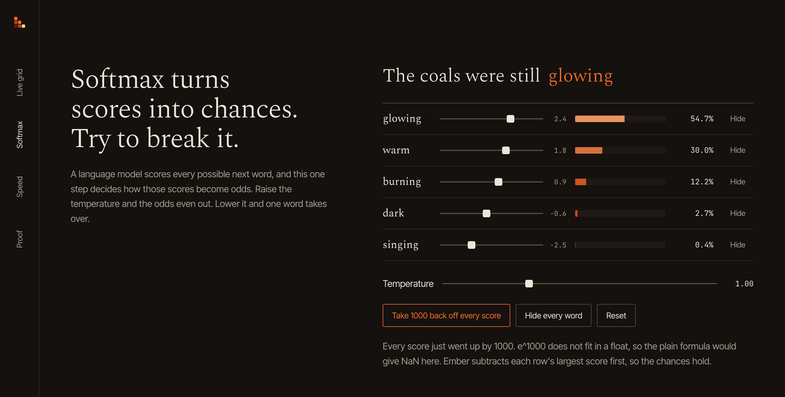
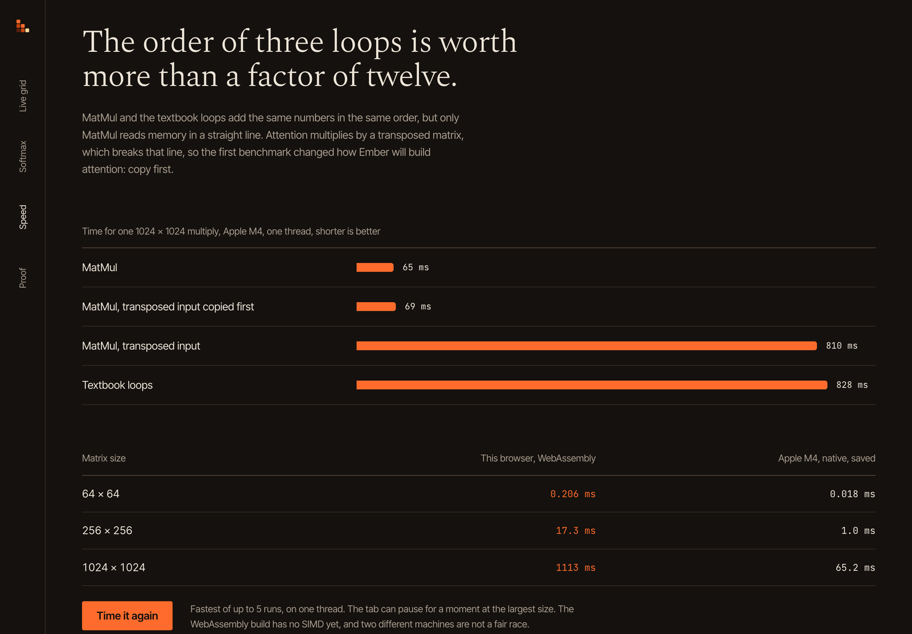

# Ember

**An LLM inference engine written from scratch in C++20, with no ML framework. It loads real Llama models from Hugging Face, runs them on a laptop, and compiles to WebAssembly for the browser.**

[](https://github.com/hammy229/ember/actions/workflows/ci.yml)
[](LICENSE)



The grid is not an animation. The browser is running queries and keys through the real `MatMul` and `Softmax`, compiled from C++, and each coal shows its value on hover.

## Results

Every number here comes from one run of [`scripts/results.sh`](scripts/results.sh), saved in [docs/results/2026-11-08-apple-m4.md](docs/results/2026-11-08-apple-m4.md) with the commit, compiler, and machine. Rerun it and you get your own copy.

| Claim | Measured | How it is checked |
|---|---|---|
| The math is right | Largest logit difference 4.2e-5 from a separate NumPy Llama, across all 32,000 logits, with the same top token at all 156 positions tested | `scripts/reference_logits.py` on three inputs from 5 to 128 tokens |
| It runs a real model | 15,191,712 parameters, 815 tokens a second on one thread, 147 MB of memory for the whole process | `ember_bench_model` on the TinyStories Llama |
| Speed work is measured, not guessed | Spelling out the SIMD registers in `Linear` took one token from 1.98 ms to 1.23 ms (1.6x) with logits identical to the bit | `results.sh --before 08c2e73` builds the old commit and times both |
| It is honest about where it stands | NumPy with Apple's hand-tuned BLAS runs 128 tokens in 21.0 ms. Ember takes 158.1 ms, 7.5x slower | Same script, same machine, same tokens |
| Bad input cannot crash it | Every truncation and thousands of corrupted headers fail cleanly under AddressSanitizer, and libFuzzer runs on every push | `tests/loader_corruption_test.cpp`, `fuzz/`, CI |
| The tests reach the code | 326 tests, covering 97.8% of lines and 86.0% of branches in `src/` | `scripts/coverage.sh` |



The gap to NumPy is the to-do list: hand-written NEON kernels, more than one thread, and 8-bit weights, each with a before and after from the same script.

## Why it matters

Most people who use a language model send their words to someone else's server. That costs money for every request, needs a connection, and means the text leaves the device, which rules it out for things like medical notes or schoolwork that should stay private. An engine small enough to run on a laptop, and soon in a browser tab, does none of that. The model runs where the data already is, for free.

Doing that well is mostly engineering: loading weights safely from files nobody checked, getting the math exactly right, fitting in a browser's memory, and making it fast without guessing. Ember is a from-scratch attempt at all of it, with the evidence in the repo.

## How it works

1. **Load.** `MappedFile` maps `model.safetensors` read-only. A strict JSON parser reads the header, every offset and shape is checked, and f16 or bf16 weights are widened to f32 exactly. ([docs/loader.md](docs/loader.md))
2. **Allocate.** One arena per forward pass hands out scratch memory by moving a pointer, and scoped marks give it all back at once. ([docs/memory.md](docs/memory.md))
3. **Compute.** Embedding, then per layer RMS norm, attention with RoPE and grouped-query heads, and a SwiGLU MLP, then the output layer. Each op follows Hugging Face's Llama code step by step, including where it rounds. ([docs/forward.md](docs/forward.md), [docs/ops.md](docs/ops.md))
4. **Run anywhere.** The same C++ compiles natively and to WebAssembly, and the site calls it from the browser.

Design choices that matter:

| Choice | Why |
|---|---|
| `Status` and `StatusOr` instead of exceptions | Every failure is a value the caller must handle, and ignoring one is a compile error |
| Read-only `TensorView` for weights | Writing to a mapped weight would crash, so it does not compile |
| Overlap checks on every op | Writing over an input you are still reading gives a silent wrong answer, so it is refused |
| Copy transposed keys before `MatMul` | Measured 11.7x faster at 1024 x 1024 than reading them sideways ([docs/ops.md](docs/ops.md)) |
| Explicit SIMD vector types in `Linear` | Small rewrites swung the auto-vectorizer's speed by more than half, so the registers are spelled out |



On the site, visitors can drag the softmax scores and try to break it. Adding 1000 to every score would overflow the plain formula into NaN, and hiding every word makes the engine return an error rather than an answer.

## Tech stack

C++20, CMake and Ninja, GoogleTest, libFuzzer, AddressSanitizer and UBSan, clang source coverage, Emscripten (WebAssembly), Next.js and TypeScript for the site, Python and NumPy for the reference checks, GitHub Actions on Linux and macOS.

## Getting started

You need CMake 3.24+, Ninja, and a C++20 compiler.

```sh
cmake --preset release && cmake --build --preset release
./scripts/fetch-model.sh                       # 15M parameter test model into models/, which git ignores
./build/release/ember inspect models/tinyllama-15M
./build/release/ember logits models/tinyllama-15M 1 9038 2501 263 931   # "Once upon a time"
```

The site needs Node 24+ and Emscripten:

```sh
./scripts/build-wasm.sh
cd web && npm ci && npm run dev
```

To use Ember inside another CMake project, add it with `add_subdirectory`. Its tests and `-Werror` stay off unless you turn on `EMBER_BUILD_TESTS` and `EMBER_WERROR`.

## Project structure

```
include/ember/   public headers: tensors, arena, ops, layers, loader, forward pass
src/             the engine
tests/           GoogleTest suites, reference implementations, corruption tests
fuzz/            libFuzzer targets for the JSON parser and the whole loader
tools/           the ember CLI and the benchmarks
scripts/         fetch the model, benchmark, coverage, results report, reference logits
wasm/            exports for the WebAssembly build
web/             the Next.js site
docs/            one design doc per layer, the plan, saved benchmarks and results
```

## Testing

```sh
cmake --preset debug && cmake --build --preset debug && ctest --preset debug
cmake --preset sanitize && cmake --build --preset sanitize && ctest --preset sanitize
./scripts/coverage.sh       # line and branch coverage of src/
./scripts/results.sh        # every number in this README, saved with the machine and commit
```

CI runs on every push: a clang-format check, release and AddressSanitizer plus UBSan builds with GCC, a release build with Apple clang on macOS, a minute of fuzzing per target, the WebAssembly build with its smoke test, and the site build. The forward pass is checked against a separate double-precision implementation, and breaking RoPE, the attention scale, or the causal mask on purpose makes those tests fail.



The bars come from [one saved run of `scripts/bench.sh`](docs/benchmarks/2026-11-06-m4.txt). The orange column is measured live in whatever browser opens the page.

## Limitations and next steps

- No tokenizer or KV cache yet, so it does not generate text. Both are next, then text generation in the browser.
- One thread, and 7.5x slower than NumPy with Apple's BLAS on the same model.
- Llama-architecture models in one safetensors file. Llama 3's scaled RoPE is refused rather than run wrong.
- The dated plan, with what is done and what is next, is in [docs/PLAN.md](docs/PLAN.md).

## License

MIT, see [LICENSE](LICENSE). Built by [Arham Doshi](https://arhamdoshi.dev).
